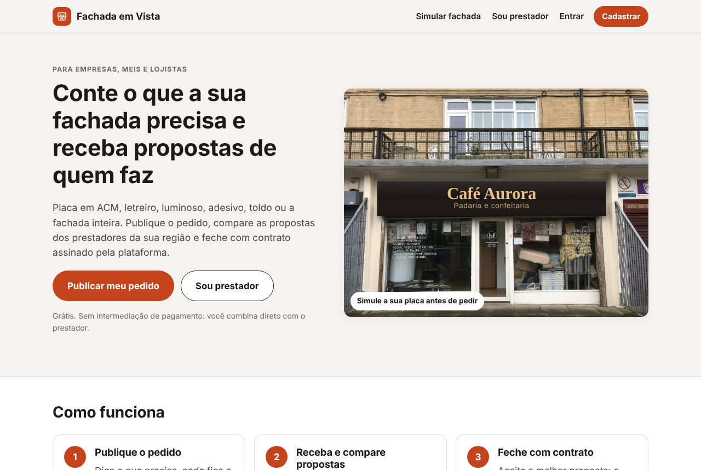

# Fachada em Vista

Marketplace de fachada e comunicação visual. Empresas, MEIs e lojistas publicam o que precisam (placa em ACM, letreiro, luminoso, adesivo, toldo, fachada completa). Prestadores da região enviam propostas. A empresa aceita uma, e o contrato é gerado e assinado eletronicamente pelas duas partes. Por enquanto, tudo é grátis.



## Rodar

```bash
npm install
npm start            # http://localhost:3000
```

Requer Node 22.13 ou mais novo, porque usa o SQLite embutido (`node:sqlite`).

- **Administração:** `/admin`. No primeiro start, o acesso é **admin@fachadaemvista.local / fachada-demo-2026**. Para usar outro, defina `ADMIN_EMAIL` e `ADMIN_PASSWORD` antes do primeiro start.
- **Teste ponta a ponta:** com o servidor rodando, `python3 tests/make-fixtures.py tests/fixtures && BASE=http://localhost:3000 npm run test:e2e`. São 53 verificações, feitas no Chromium com Playwright. O cadastro tem limite de 8 contas por hora por IP, então reinicie o servidor entre execuções seguidas.

## Como funciona

| Quem | Tela | O que faz |
|---|---|---|
| Qualquer pessoa | `/criar` | Simulador: aplica a placa (nome, frase, logo, estilo e cores) numa foto real de fachada ou na foto do próprio ponto, de dia ou de noite. "Usar no meu pedido" anexa a imagem ao pedido. |
| Empresa / MEI | `/cadastro?tipo=empresa` | Cadastro com CNPJ, MEI ou CPF (dígitos verificados), WhatsApp e cidade |
| Empresa | `/pedidos/novo` | Pedido com serviços, descrição, medidas, local, orçamento, prazo, fotos, logo, referências e simulação |
| Empresa | `/pedidos/:id` | Propostas lado a lado (valor, prazo, o que inclui, avaliação do prestador), conversa, aceite |
| Prestador | `/cadastro?tipo=prestador` | Cadastro com os serviços que faz e se atende o estado todo |
| Prestador | `/oportunidades` | Pedidos abertos, filtrados por estado, cidade e serviço |
| Prestador | `/oportunidades/:id` | Detalhes e fotos do pedido. Envia, edita ou retira a proposta. |
| Os dois | `/propostas/:id/conversa` | Conversa entre a empresa e o prestador, com aviso de mensagem nova |
| Os dois | `/contratos/:id` | Contrato, assinaturas, contatos liberados, conclusão, avaliação, impressão ou PDF |
| Admin | `/admin` | Números gerais, pedidos, contas, bloqueio de contas |

### Ciclo do pedido

1. **Recebendo propostas:** a empresa publica o pedido.
2. **Aguardando assinatura:** a empresa aceita uma proposta. O contrato é gerado e assinado por ela, e as outras propostas ficam em espera.
3. **Contratado:** o prestador assina. As outras propostas viram "Não escolhida", e os contatos (WhatsApp e e-mail) são liberados para os dois.
   - Se o prestador recusar, ou se a empresa desistir antes da assinatura, o pedido volta a receber propostas.
4. **Concluído:** a empresa marca o serviço como entregue e avalia o prestador. A nota aparece no perfil público do prestador.

## Privacidade e segurança

- **Antes do contrato:** os prestadores veem do pedido só a cidade, o bairro, a descrição e as fotos. O nome, o WhatsApp, o e-mail e o documento da empresa só aparecem no contrato assinado pelas duas partes.
- **Fotos:** os arquivos são validados pelo conteúdo real (JPG, PNG, WEBP, além de SVG e PDF para a logo). Ficam fora da pasta pública e só são servidos para a empresa dona do pedido, para prestadores (enquanto o pedido está aberto, ou se enviaram proposta) e para o admin.
- **Contrato:** o texto é gravado no momento do aceite, com hash SHA-256. Cada assinatura registra data, hora, IP e navegador, como assinatura eletrônica simples (MP 2.200-2/2001, art. 10, § 2º, e Lei 14.063/2020). O contrato é um modelo. Para valores altos, recomende revisão jurídica.
- **Acesso:**
  - As senhas são guardadas com scrypt, e a sessão usa cookie HttpOnly e SameSite.
  - Todo POST vindo de outra origem é bloqueado (CSRF).
  - Há limite de tentativas de login e de cadastros.
  - A CSP é restrita: só scripts do próprio site.
- **Duplicidade:** pedidos e mensagens usam chave de idempotência, então envios repetidos não duplicam nada. Cada prestador tem no máximo uma proposta por pedido. E existe no máximo um contrato ativo por pedido, garantido pelo banco.

## Publicar (site próprio)

O jeito mais simples é o **Render**, que usa o `render.yaml` e o `Dockerfile` deste repositório:

1. Crie uma conta em render.com e conecte o GitHub.
2. Vá em **New › Blueprint**, escolha este repositório e o branch.
3. Preencha `ADMIN_EMAIL` e `ADMIN_PASSWORD`.
4. O plano precisa ser pago (a partir de US$ 7/mês) por causa do **disco persistente** em `/data`, onde ficam o banco e as fotos. Sem ele, tudo se perde a cada deploy.
5. Para usar um domínio próprio (ex.: fachadaemvista.com.br), configure-o em **Settings › Custom Domains**. O HTTPS é automático.

Faça backup da pasta `/data` periodicamente.

## O que ainda não existe

| Item | Situação |
|---|---|
| Avisos por e-mail ou WhatsApp automático | Não há. Os avisos aparecem no painel (contador de mensagens e contratos para assinar). Para e-mail, conecte um serviço como Resend, SES ou SMTP. |
| Recuperação de senha | Não há ainda. Depende do envio de e-mail. |
| Cobrança (planos, comissão) | Não há. O uso é grátis nesta fase. |
| Portfólio com fotos no perfil do prestador | O banco já tem a regra de arquivo `portfolio`, mas ainda não tem tela. |

Fotos base do simulador: chris.rycroft (CC BY 2.0), Myotus (CC BY 4.0) e Wikociewie (CC0), via Wikimedia Commons. As imagens geradas trazem o crédito.
